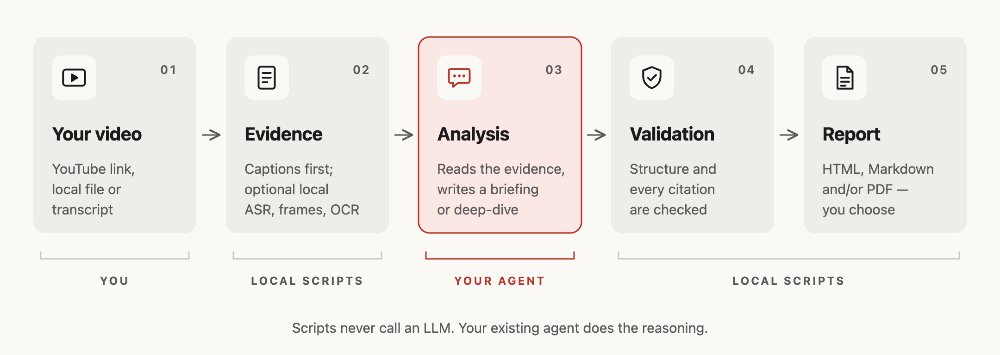

<!-- README translation source: README.md sha256=8cdf05967411b602f4ee581320b29a21fa21b114c26fc328d485f78c7c9d2bc7 -->
<h1 align="center">Playback Notes</h1>

<p align="center">
  <a href="README.md">English</a> · <a href="README.zh-CN.md">简体中文</a> · <a href="README.ja.md">日本語</a> · <a href="README.ko.md">한국어</a> · <strong>Español</strong>
</p>

<p align="center">
  <strong>Informes legibles de todo lo que ves o escuchas, con la evidencia incluida.</strong><br>
  Una skill para Claude Code, Codex y pi. Sin otra clave de API: el agente que ya usas escribe el informe,<br>
  cada afirmación enlaza a su momento en la grabación y las citas se verifican antes de exportar.
</p>

<p align="center">
  <a href="https://github.com/AgwaB/playback-notes/actions/workflows/windows.yml"></a>
  <a href="https://nodejs.org/"></a>
  <a href="#ejemplo-de-resultado"></a>
</p>

<p align="center">
  <a href="#ejemplo-de-resultado">Ejemplo de resultado</a> ·
  <a href="#cómo-funciona">Cómo funciona</a> ·
  <a href="#uso">Uso</a> ·
  <a href="#instalación">Instalación</a> ·
  <a href="#uso-de-tokens">Uso de tokens</a>
</p>

## Ejemplo de resultado

La charla de Andrej Karpathy [“[1hr Talk] Intro to Large Language Models”](https://www.youtube.com/watch?v=zjkBMFhNj_g), resumida de las dos formas con esta skill:


<p align="center">Lee los informes completos: <a href="examples/karpathy-intro-llms/briefing.md"><strong>Briefing</strong></a> · <a href="examples/karpathy-intro-llms/deep-dive.md"><strong>Deep-dive</strong></a> (Markdown, en inglés; cada marca de tiempo abre el video en ese momento)</p>

<p align="center"><sub>Resumen no oficial, sin relación con el creador ni respaldado por él. Escrito a partir de los subtítulos automáticos del video; no incluye la transcripción. Miniatura del video © Andrej Karpathy.</sub></p>

## Cómo funciona



## Uso

Envía a tu agente un enlace de YouTube, una publicación de video en X, el enlace de un **episodio** de Apple Podcasts, o un archivo de audio o video o una URL directa. También puedes aportar una transcripción SRT, VTT o TXT.

- **Briefing**: las conclusiones clave y por qué se sostienen.
- **Deep-dive**: explicaciones detalladas, ejemplos y salvedades.

```text
Hazme un briefing de este video en HTML y Markdown: <url>
Analiza esta grabación en profundidad, en español, y exporta un PDF: <path>
```

Elige **HTML, Markdown, PDF** o cualquier combinación; si no lo indicas, el agente te pregunta. Los informes se guardan por defecto en `.playback-notes/reports/` dentro de tu carpeta de trabajo.

Haz preguntas de seguimiento sobre la misma fuente y obtendrás respuestas con marcas de tiempo citadas. Si no hay transcripción disponible, el agente pregunta antes de transcribir localmente.

## Instalación

Requiere **Node.js 24.15 o posterior dentro de la serie 24.x, o 26 o posterior** (Node 25 no es compatible) y **git**, que `npx skills add` usa para descargar la skill (en Windows: `winget install --id Git.Git -e`).

```bash
npx skills add AgwaB/playback-notes -g
(cd ~/.agents/skills/playback-notes && npm ci)
```

**Las dos líneas son necesarias.** La primera instala la skill con la [CLI `skills`](https://github.com/vercel-labs/skills) para los agentes que elijas, como Claude Code, Codex y pi. La segunda instala sus dependencias. En Windows PowerShell, usa en su lugar los [comandos de PowerShell](references/windows.md).

Al iniciarse, tu agente comprueba qué herramientas opcionales hay (ffmpeg, yt-dlp, whisper.cpp, un navegador para PDF, OCR), te dice qué necesitaría cada opción y te ofrece el comando de instalación para tu sistema; no se instala nada sin tu aprobación. Para hacer la comprobación tú mismo: `node ~/.agents/skills/playback-notes/scripts/doctor.mjs`.

Para actualizarla o eliminarla:

```bash
npx skills update playback-notes -g
(cd ~/.agents/skills/playback-notes && npm ci)  # al actualizar se eliminan las dependencias

npx skills remove playback-notes -g
```

¿La instalaste como `video-summarizer` antes del cambio de nombre? Elimina esa copia con `npx skills remove video-summarizer -g`.

<details>
<summary><strong>Alternativa:</strong> instalación manual (copia de solo lectura)</summary>

```bash
git clone https://github.com/AgwaB/playback-notes.git
cd playback-notes
npm ci
node scripts/install.mjs --link ~/.claude/skills/playback-notes
```

Esto instala una copia de solo lectura en `~/.agents/skills/playback-notes`, donde la encuentran Codex y pi. `--link` conecta Claude Code; omítelo si no usas Claude Code. Para actualizar, haz pull de este repositorio, ejecuta `npm ci` y repite el último comando.

</details>

En Windows, sigue la [configuración de PowerShell](references/windows.md); en WSL, la [guía de WSL](references/wsl.md).

### Opcional: transcripción local

Las grabaciones sin subtítulos necesitan reconocimiento de voz en tu computadora: todas las publicaciones de video en X, algunos videos de YouTube, los podcasts sin transcripción publicada y tus propios archivos. El agente pregunta antes de transcribir y nunca instala nada por su cuenta. En macOS con Homebrew:

```bash
brew install whisper.cpp ffmpeg
mkdir -p ~/.agents/models
curl -L -o ~/.agents/models/ggml-large-v3-turbo.bin \
  https://huggingface.co/ggerganov/whisper.cpp/resolve/main/ggml-large-v3-turbo.bin  # 1.6 GB
```

Después guarda sus ubicaciones en `~/.agents/playback-notes-asr.json`, con tu propia carpeta personal:

```json
{
  "localAsrExecutable": "/opt/homebrew/bin/whisper-cli",
  "localAsrModel": "/Users/you/.agents/models/ggml-large-v3-turbo.bin"
}
```

En los Mac con Intel, Homebrew usa `/usr/local/bin`. `ggml-small.bin` (490 MB, misma dirección) es más rápido pero comete más errores, sobre todo con los nombres. En Linux, compila [whisper.cpp](https://github.com/ggml-org/whisper.cpp); en Windows, consulta la [configuración de PowerShell](references/windows.md#local-transcription).

## Uso de tokens

La misma charla de una hora de Karpathy · `openai-codex/gpt-6.1-sol` (medium) · HTML + Markdown en inglés · subtítulos automáticos. Promedios de **2 ejecuciones por modo**; entre paréntesis, los rangos observados.

| Modo | Tokens procesados (media; rango) | Entrada en caché | Costo estimado |
| --- | --- | --- | --- |
| **Briefing** | **420k** (307k–533k) | 349k | $0.212 |
| **Deep-dive** | **679k** (526k–832k) | 599k | $0.294 |

Los totales incluyen el contexto en caché releído en todos los turnos, no el tamaño de ventana de contexto necesario. Los costos son estimaciones del host; el uso y los cargos reales varían.

## Licencia

[MIT](LICENSE)
