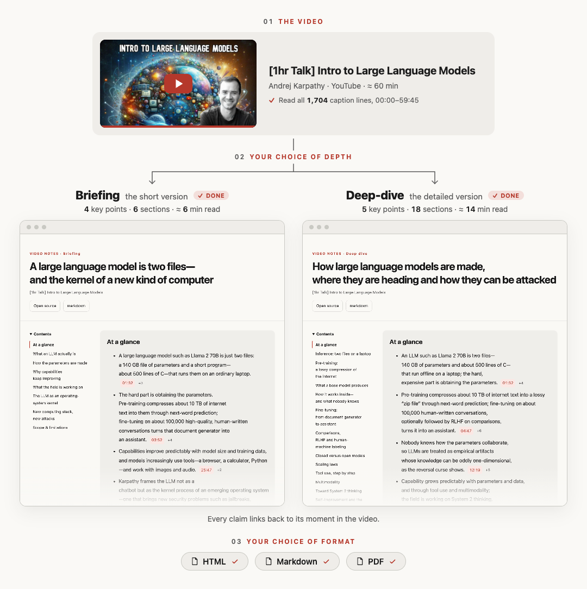
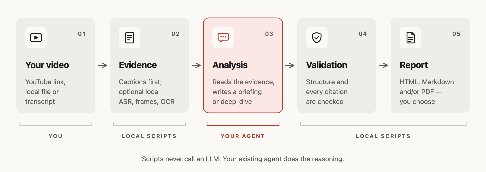

<!-- README translation source: README.md sha256=8cdf05967411b602f4ee581320b29a21fa21b114c26fc328d485f78c7c9d2bc7 -->
<h1 align="center">Playback Notes</h1>

<p align="center">
  <a href="README.md">English</a> · <a href="README.zh-CN.md">简体中文</a> · <strong>日本語</strong> · <a href="README.ko.md">한국어</a> · <a href="README.es.md">Español</a>
</p>

<p align="center">
  <strong>観る・聴くあらゆるものを、根拠付きの読みやすいレポートに。</strong><br>
  Claude Code・Codex・pi 向けのスキルです。別途 API キーは不要。いつものエージェントがレポートを書き、<br>
  すべての主張は録画・録音の該当箇所にリンクされ、エクスポート前に引用が検証されます。
</p>

<p align="center">
  <a href="https://github.com/AgwaB/playback-notes/actions/workflows/windows.yml"></a>
  <a href="https://nodejs.org/"></a>
  <a href="#出力例"></a>
</p>

<p align="center">
  <a href="#出力例">出力例</a> ·
  <a href="#仕組み">仕組み</a> ·
  <a href="#使い方">使い方</a> ·
  <a href="#インストール">インストール</a> ·
  <a href="#トークン使用量">トークン使用量</a>
</p>

## 出力例

Andrej Karpathy の [“[1hr Talk] Intro to Large Language Models”](https://www.youtube.com/watch?v=zjkBMFhNj_g) を、このスキルで 2 通りに要約しました。



<p align="center">レポート全文：<a href="examples/karpathy-intro-llms/briefing.md"><strong>ブリーフィング</strong></a> · <a href="examples/karpathy-intro-llms/deep-dive.md"><strong>ディープダイブ</strong></a>（Markdown・英語。タイムスタンプをクリックすると動画がその場面から開きます）</p>

<p align="center"><sub>非公式の要約であり、制作者とは無関係で、制作者の承認も受けていません。動画の自動字幕をもとに作成しており、文字起こしは含みません。動画サムネイル © Andrej Karpathy。</sub></p>

## 仕組み



## 使い方

YouTube のリンク、X の動画投稿、Apple Podcasts の**エピソード**リンク、または音声・動画ファイルや直接 URL をエージェントに送ってください。SRT・VTT・TXT の文字起こしを渡すこともできます。

- **ブリーフィング（Briefing）**：主要な結論と、その根拠。
- **ディープダイブ（Deep-dive）**：詳しい解説、具体例、注意点。

```text
この動画をブリーフィングにまとめて、HTML と Markdown で出力して: <url>
この録音を日本語で詳しく分析して、PDF に書き出して: <path>
```

**HTML・Markdown・PDF** から自由に選べ、組み合わせることもできます。指定しなければエージェントが尋ねます。レポートは既定で作業フォルダーの `.playback-notes/reports/` に保存されます。

同じソースについて続けて質問すると、タイムスタンプ付きの引用で答えます。文字起こしが手に入らない場合は、ローカルで文字起こしする前にエージェントが確認します。

## インストール

**Node.js 24.x の 24.15 以降、または 26 以降**（Node 25 は非対応）と、`npx skills add` がスキルの取得に使う **git** が必要です（Windows：`winget install --id Git.Git -e`）。

```bash
npx skills add AgwaB/playback-notes -g
(cd ~/.agents/skills/playback-notes && npm ci)
```

**2 行とも必要です。** 1 行目は [`skills` CLI](https://github.com/vercel-labs/skills) で、Claude Code・Codex・pi など選んだエージェントにスキルをインストールします。2 行目は依存関係をインストールします。Windows PowerShell では、代わりに [PowerShell 用のコマンド](references/windows.md)を使ってください。

エージェントは起動時に任意のツール（ffmpeg、yt-dlp、whisper.cpp、PDF 用のブラウザー、OCR）の有無を確認し、選んだ機能に何が必要かを伝え、お使いのシステム向けのインストールコマンドを提案します。了承なしに何かをインストールすることはありません。自分で確認するには：`node ~/.agents/skills/playback-notes/scripts/doctor.mjs`

更新・削除するには：

```bash
npx skills update playback-notes -g
(cd ~/.agents/skills/playback-notes && npm ci)  # 更新すると依存関係が削除されます

npx skills remove playback-notes -g
```

名称変更の前に `video-summarizer` としてインストールしていた場合は、`npx skills remove video-summarizer -g` でそのコピーを削除してください。

<details>
<summary><strong>代替手段：</strong>手動インストール（読み取り専用のコピー）</summary>

```bash
git clone https://github.com/AgwaB/playback-notes.git
cd playback-notes
npm ci
node scripts/install.mjs --link ~/.claude/skills/playback-notes
```

`~/.agents/skills/playback-notes` に読み取り専用のコピーをインストールします。Codex と pi はここからスキルを見つけます。`--link` は Claude Code と連携するためのもので、Claude Code を使わない場合は省略できます。更新するには、このリポジトリを pull し、`npm ci` を実行してから最後のコマンドをもう一度実行します。

</details>

Windows では [PowerShell のセットアップ](references/windows.md)、WSL では [WSL ガイド](references/wsl.md)に従ってください。

### オプション：ローカル文字起こし

字幕のない録画・録音は、お使いのコンピューターでの音声認識が必要です。X の動画投稿はすべて、YouTube 動画の一部、文字起こしが公開されていないポッドキャスト、手元のファイルが該当します。エージェントは文字起こしの前に確認し、勝手に何かをインストールすることはありません。Homebrew のある macOS では：

```bash
brew install whisper.cpp ffmpeg
mkdir -p ~/.agents/models
curl -L -o ~/.agents/models/ggml-large-v3-turbo.bin \
  https://huggingface.co/ggerganov/whisper.cpp/resolve/main/ggml-large-v3-turbo.bin  # 1.6 GB
```

次に、それぞれの場所を `~/.agents/playback-notes-asr.json` に保存します（ホームフォルダーはご自身のものに置き換えてください）：

```json
{
  "localAsrExecutable": "/opt/homebrew/bin/whisper-cli",
  "localAsrModel": "/Users/you/.agents/models/ggml-large-v3-turbo.bin"
}
```

Intel Mac の Homebrew は `/usr/local/bin` を使います。`ggml-small.bin`（490 MB、同じアドレス）は高速ですが、特に人名で誤りが増えます。Linux では [whisper.cpp](https://github.com/ggml-org/whisper.cpp) をビルドし、Windows では [PowerShell のセットアップ](references/windows.md#local-transcription)を参照してください。

## トークン使用量

同じ 1 時間の Karpathy 講演 · `openai-codex/gpt-6.1-sol`（medium）· 英語の HTML + Markdown · 自動字幕。**モードごとに 2 回実行**した平均で、括弧内は実測の範囲です。

| モード | 処理トークン数（平均、範囲） | キャッシュされた入力 | 推定コスト |
| --- | --- | --- | --- |
| **ブリーフィング** | **420k**（307k–533k） | 349k | $0.212 |
| **ディープダイブ** | **679k**（526k–832k） | 599k | $0.294 |

合計には全ターンで再読み込みされたキャッシュ済みコンテキストが含まれ、必要なコンテキストウィンドウのサイズを表すものではありません。コストはホストによる推定値で、実際の使用量や料金は異なる場合があります。

## ライセンス

[MIT](LICENSE)
