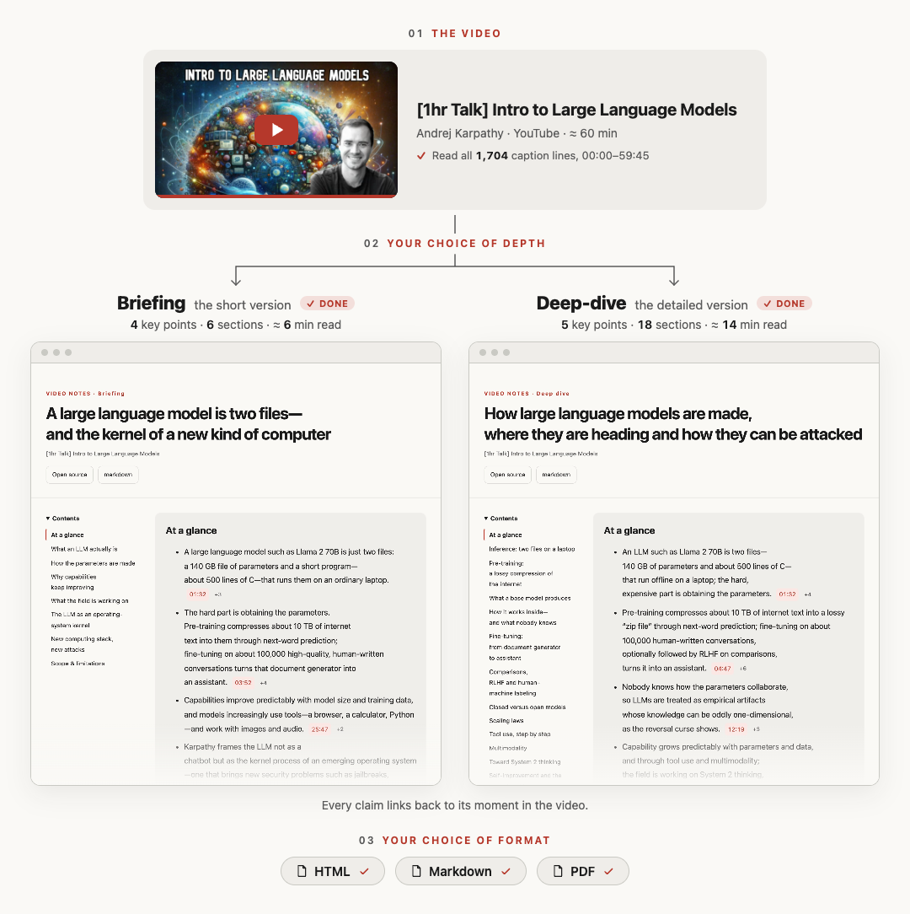
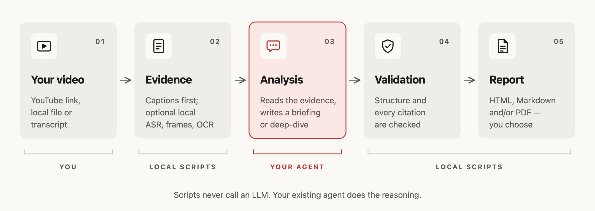

<!-- README translation source: README.md sha256=8cdf05967411b602f4ee581320b29a21fa21b114c26fc328d485f78c7c9d2bc7 -->
<h1 align="center">Playback Notes</h1>

<p align="center">
  <a href="README.md">English</a> · <a href="README.zh-CN.md">简体中文</a> · <a href="README.ja.md">日本語</a> · <strong>한국어</strong> · <a href="README.es.md">Español</a>
</p>

<p align="center">
  <strong>보고 듣는 모든 것을, 근거가 붙은 읽기 쉬운 보고서로.</strong><br>
  Claude Code, Codex, pi용 스킬입니다. 별도 API 키가 필요 없습니다. 이미 쓰는 에이전트가 보고서를 쓰고,<br>
  모든 주장은 녹화·녹음의 해당 순간으로 연결되며, 내보내기 전에 인용을 검증합니다.
</p>

<p align="center">
  <a href="https://github.com/AgwaB/playback-notes/actions/workflows/windows.yml"></a>
  <a href="https://nodejs.org/"></a>
  <a href="#예시-결과"></a>
</p>

<p align="center">
  <a href="#예시-결과">예시 결과</a> ·
  <a href="#작동-방식">작동 방식</a> ·
  <a href="#사용법">사용법</a> ·
  <a href="#설치">설치</a> ·
  <a href="#토큰-사용량">토큰 사용량</a>
</p>

## 예시 결과

Andrej Karpathy의 [“[1hr Talk] Intro to Large Language Models”](https://www.youtube.com/watch?v=zjkBMFhNj_g)를 이 스킬로 두 가지 방식으로 요약했습니다.



<p align="center">전체 보고서 보기: <a href="examples/karpathy-intro-llms/briefing.md"><strong>브리핑</strong></a> · <a href="examples/karpathy-intro-llms/deep-dive.md"><strong>심층 분석</strong></a> (Markdown, 영어. 타임스탬프를 누르면 영상이 그 순간부터 열립니다)</p>

<p align="center"><sub>비공식 요약이며, 영상 제작자와 관련이 없고 제작자의 보증을 받지 않았습니다. 영상의 자동 자막으로 작성했으며, 대본은 포함하지 않았습니다. 영상 썸네일 © Andrej Karpathy.</sub></p>

## 작동 방식



## 사용법

에이전트에게 YouTube 링크, X의 동영상 게시물, Apple Podcasts **에피소드** 링크, 또는 오디오·동영상 파일이나 직접 URL을 보내세요. SRT, VTT, TXT 대본을 줄 수도 있습니다.

- **브리핑(Briefing)** — 핵심 결론과 그 근거.
- **심층 분석(Deep-dive)** — 자세한 설명, 예시, 주의할 점.

```text
이 영상을 브리핑으로 정리해서 HTML과 Markdown으로 줘: <url>
이 녹음을 한국어로 깊이 분석해서 PDF로 내보내 줘: <path>
```

**HTML, Markdown, PDF** 중 하나를 고르거나 여러 개를 함께 고를 수 있습니다. 말하지 않으면 에이전트가 묻습니다. 보고서는 기본적으로 작업 폴더의 `.playback-notes/reports/`에 저장됩니다.

같은 원본에 대해 이어서 질문하면 타임스탬프가 달린 답을 받을 수 있습니다. 대본을 구할 수 없으면 에이전트가 로컬 음성 인식 전에 먼저 묻습니다.

## 설치

**Node.js 24.x 중 24.15 이상, 또는 26 이상**(Node 25는 지원하지 않음)과, `npx skills add`가 스킬을 받아올 때 쓰는 **git**이 필요합니다(Windows: `winget install --id Git.Git -e`).

```bash
npx skills add AgwaB/playback-notes -g
(cd ~/.agents/skills/playback-notes && npm ci)
```

**두 줄 모두 실행해야 합니다.** 첫 줄은 [`skills` CLI](https://github.com/vercel-labs/skills)로 Claude Code, Codex, pi 등 고른 에이전트에 스킬을 설치하고, 둘째 줄은 의존성을 설치합니다. Windows PowerShell에서는 [PowerShell 명령](references/windows.md)을 대신 쓰세요.

에이전트는 시작할 때 선택 도구(ffmpeg, yt-dlp, whisper.cpp, PDF용 브라우저, OCR)가 있는지 확인하고, 고른 기능에 무엇이 필요한지 알려 주며, 사용 중인 시스템에 맞는 설치 명령을 제안합니다. 승인 없이는 아무것도 설치하지 않습니다. 직접 확인하려면: `node ~/.agents/skills/playback-notes/scripts/doctor.mjs`

업데이트하거나 제거하려면:

```bash
npx skills update playback-notes -g
(cd ~/.agents/skills/playback-notes && npm ci)  # 업데이트하면 의존성이 지워집니다

npx skills remove playback-notes -g
```

이름이 바뀌기 전에 `video-summarizer`로 설치했다면, 그 사본은 `npx skills remove video-summarizer -g`로 지우세요.

<details>
<summary><strong>대안:</strong> 수동 설치(읽기 전용 사본)</summary>

```bash
git clone https://github.com/AgwaB/playback-notes.git
cd playback-notes
npm ci
node scripts/install.mjs --link ~/.claude/skills/playback-notes
```

`~/.agents/skills/playback-notes`에 읽기 전용 사본을 설치하며, Codex와 pi는 여기서 스킬을 찾습니다. `--link`는 Claude Code를 연결하므로, Claude Code를 쓰지 않으면 빼도 됩니다. 업데이트하려면 이 저장소를 pull하고 `npm ci`를 실행한 뒤 마지막 명령을 다시 실행하세요.

</details>

Windows에서는 [PowerShell 설정](references/windows.md)을, WSL에서는 [WSL 안내](references/wsl.md)를 따르세요.

### 선택 사항: 로컬 음성 인식

자막이 없는 녹음은 내 컴퓨터에서 음성을 텍스트로 바꿔야 합니다. X의 모든 동영상 게시물, 일부 YouTube 영상, 대본이 공개되지 않은 팟캐스트, 직접 가진 파일이 그렇습니다. 에이전트는 음성 인식 전에 먼저 묻고, 스스로 아무것도 설치하지 않습니다. Homebrew가 있는 macOS에서는:

```bash
brew install whisper.cpp ffmpeg
mkdir -p ~/.agents/models
curl -L -o ~/.agents/models/ggml-large-v3-turbo.bin \
  https://huggingface.co/ggerganov/whisper.cpp/resolve/main/ggml-large-v3-turbo.bin  # 1.6 GB
```

그런 다음 두 파일의 위치를 `~/.agents/playback-notes-asr.json`에 저장하세요. 홈 폴더는 본인 것으로 바꿉니다.

```json
{
  "localAsrExecutable": "/opt/homebrew/bin/whisper-cli",
  "localAsrModel": "/Users/you/.agents/models/ggml-large-v3-turbo.bin"
}
```

Intel Mac에서는 Homebrew가 `/usr/local/bin`을 씁니다. `ggml-small.bin`(490MB, 같은 주소)은 더 빠르지만 실수가 더 많고, 특히 이름을 자주 틀립니다. Linux에서는 [whisper.cpp](https://github.com/ggml-org/whisper.cpp)를 빌드하고, Windows에서는 [PowerShell 설정](references/windows.md#local-transcription)을 보세요.

## 토큰 사용량

같은 1시간짜리 Karpathy 강연 · `openai-codex/gpt-6.1-sol`(medium) · 영어 HTML + Markdown · 자동 자막. **모드별 2회 실행**의 평균이며, 괄호 안은 실제로 관측한 범위입니다.

| 모드 | 처리 토큰(평균, 범위) | 캐시된 입력 | 추정 비용 |
| --- | --- | --- | --- |
| **브리핑** | **420k** (307k–533k) | 349k | $0.212 |
| **심층 분석** | **679k** (526k–832k) | 599k | $0.294 |

합계에는 모든 턴에서 다시 읽은 캐시 컨텍스트가 포함되며, 필요한 컨텍스트 창 크기를 뜻하지 않습니다. 비용은 호스트의 추정치이며, 실제 사용량과 요금은 달라질 수 있습니다.

## 라이선스

[MIT](LICENSE)
