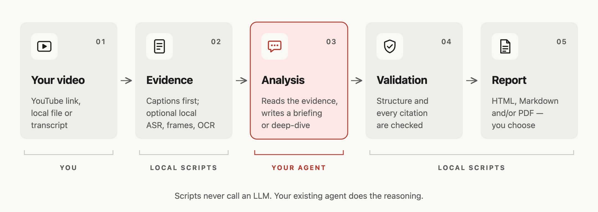

<h1 align="center">Playback Notes</h1>

<p align="center">
  <strong>Readable reports from anything you watch or listen to—with the evidence attached.</strong><br>
  A skill for Claude Code, Codex and pi. No separate API key: the agent you already use writes the report,<br>
  every claim links to its moment in the recording, and the citations are checked before export.
</p>

<p align="center">
  <a href="https://github.com/AgwaB/playback-notes/actions/workflows/windows.yml"></a>
  <a href="https://nodejs.org/"></a>
  <a href="#example-output"></a>
</p>

<p align="center">
  <a href="#example-output">Example output</a> ·
  <a href="#how-it-works">How it works</a> ·
  <a href="#usage">Usage</a>
</p>

## Example output

Andrej Karpathy's [“[1hr Talk] Intro to Large Language Models”](https://www.youtube.com/watch?v=zjkBMFhNj_g), summarized both ways with this skill:


<p align="center">Read the full reports: <a href="examples/karpathy-intro-llms/briefing.md"><strong>Briefing</strong></a> · <a href="examples/karpathy-intro-llms/deep-dive.md"><strong>Deep-dive</strong></a> (Markdown; each timestamp opens the video at that moment)</p>

<p align="center"><sub>Unofficial summary, not affiliated with or endorsed by the creator. Written from the video's automatic captions; the transcript is not included. Video thumbnail © Andrej Karpathy.</sub></p>

## How it works



## Usage

### 1. Install

Requires **Node.js 24.15+ within the 24.x line, or 26+** (Node 25 is not supported).

```bash
npx skills add AgwaB/playback-notes -g
(cd ~/.agents/skills/playback-notes && npm ci)
```

**Both lines are required.** The first installs the skill with the [`skills` CLI](https://github.com/vercel-labs/skills) for the agents you pick, such as Claude Code, Codex and pi. The second installs its dependencies. In Windows PowerShell, use the [PowerShell commands](references/windows.md) instead.

To update or remove it:

```bash
npx skills update playback-notes -g
(cd ~/.agents/skills/playback-notes && npm ci)  # updating removes the dependencies

npx skills remove playback-notes -g
```

Installed it as `video-summarizer` before the rename? Remove that copy with `npx skills remove video-summarizer -g`.

<details>
<summary><strong>Alternative:</strong> manual install (read-only copy)</summary>

```bash
git clone https://github.com/AgwaB/playback-notes.git
cd playback-notes
npm ci
node scripts/install.mjs --link ~/.claude/skills/playback-notes
```

This installs a read-only copy in `~/.agents/skills/playback-notes`, where Codex and pi find it. `--link` connects Claude Code; omit it if you don't use Claude Code. To update, pull this repository, run `npm ci`, then repeat the last command.

</details>

On Windows, follow the [PowerShell setup](references/windows.md); on WSL, the [WSL guide](references/wsl.md).

### 2. Ask your agent

Give it a YouTube link, an Apple Podcasts episode link, a local audio or video file (MP3, M4A, WAV, FLAC, MP4, MOV, MKV and more), a direct link to such a file, or a transcript (SRT, VTT, TXT). A podcast transcript published in the show's feed is used directly; otherwise audio is transcribed locally once you approve it. Choose how deep the report goes:

| Mode | What you get | Ask with words like | For the 1-hour example |
| --- | --- | --- | --- |
| **Briefing** | The main conclusions and why they hold | “summarize”, “briefing”, “key points” | 4 key points · 6 sections · ≈ 6 min read |
| **Deep-dive** | Topic-by-topic explanations with reasoning, examples, caveats and open questions | “in detail”, “deep-dive”, “analyze” | 5 key points · 18 sections · ≈ 14 min read |

```text
Give me a briefing on this video: <video-url>
Create a deep-dive on this lecture, in Spanish, and make a PDF too: <video-url>
Summarize this local video using the SRT file I supplied: <path>
What was decided in this meeting recording? <path-to-audio>
Give me a briefing on this episode: <apple-podcasts-episode-link>
```

If you don't name the formats, the agent asks which you want: HTML, Markdown, PDF or any combination. Otherwise it asks only for missing information or approval for optional local tools.

Reports are saved in `.playback-notes/reports/` inside the folder where you run your agent, unless you name another folder. Private working files go in `.playback-notes/work/`. The folder is git-ignored, and each run gets its own job and report revision, so repeated runs never overwrite each other.

Afterwards, keep asking about the source (“What exactly did they say about X?”). The agent answers from the same transcript and cites the moments it relies on.
