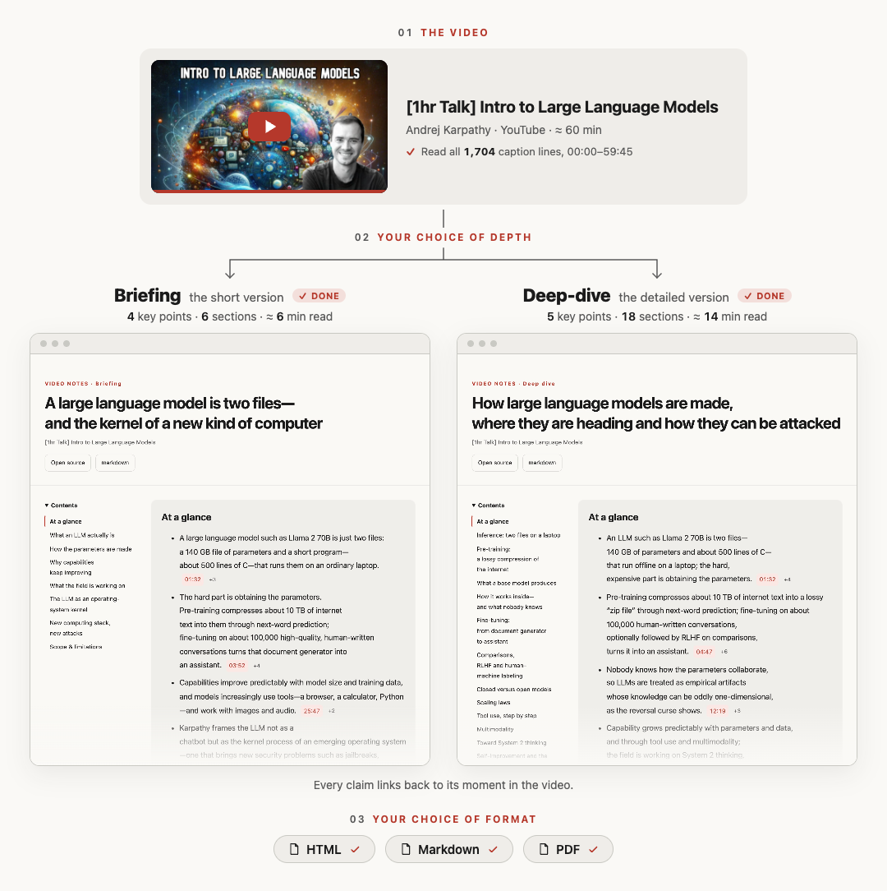
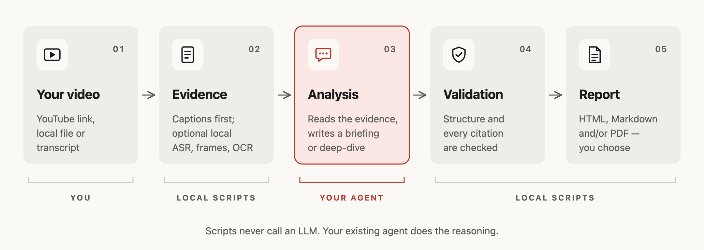

<!-- README translation source: README.md sha256=8cdf05967411b602f4ee581320b29a21fa21b114c26fc328d485f78c7c9d2bc7 -->
<h1 align="center">Playback Notes</h1>

<p align="center">
  <a href="README.md">English</a> · <strong>简体中文</strong> · <a href="README.ja.md">日本語</a> · <a href="README.ko.md">한국어</a> · <a href="README.es.md">Español</a>
</p>

<p align="center">
  <strong>把你看的、听的任何内容，变成附带证据的易读报告。</strong><br>
  适用于 Claude Code、Codex 和 pi 的技能。无需额外的 API 密钥：由你正在使用的智能体撰写报告，<br>
  每个论点都链接到录音中的对应时刻，导出前还会校验引用。
</p>

<p align="center">
  <a href="https://github.com/AgwaB/playback-notes/actions/workflows/windows.yml"></a>
  <a href="https://nodejs.org/"></a>
  <a href="#示例输出"></a>
</p>

<p align="center">
  <a href="#示例输出">示例输出</a> ·
  <a href="#工作原理">工作原理</a> ·
  <a href="#使用方法">使用方法</a> ·
  <a href="#安装">安装</a> ·
  <a href="#token-用量">Token 用量</a>
</p>

## 示例输出

用本技能以两种方式总结 Andrej Karpathy 的 [“[1hr Talk] Intro to Large Language Models”](https://www.youtube.com/watch?v=zjkBMFhNj_g)：



<p align="center">阅读完整报告：<a href="examples/karpathy-intro-llms/briefing.md"><strong>简报</strong></a> · <a href="examples/karpathy-intro-llms/deep-dive.md"><strong>深度解析</strong></a>（Markdown，英文；点击任一时间戳，视频会从该时刻开始播放）</p>

<p align="center"><sub>非官方总结，与创作者无关，也未获其认可。根据视频的自动字幕撰写，不包含文字稿。视频缩略图 © Andrej Karpathy。</sub></p>

## 工作原理



## 使用方法

把 YouTube 链接、X 上的视频帖子、Apple Podcasts 的**单集**链接，或者音频/视频文件、直链发给你的智能体。也可以提供 SRT、VTT 或 TXT 文字稿。

- **简报（Briefing）**——核心结论及其依据。
- **深度解析（Deep-dive）**——详细的解释、示例和注意事项。

```text
把这个视频整理成简报，输出 HTML 和 Markdown：<url>
用中文深入分析这段录音，并导出 PDF：<path>
```

可以选择 **HTML、Markdown、PDF** 或任意组合；没有指定时，智能体会询问。报告默认保存在工作目录的 `.playback-notes/reports/` 中。

针对同一来源继续提问，会得到带时间戳引用的回答。如果拿不到文字稿，智能体会在本地转录之前先征求你的同意。

## 安装

需要 **Node.js 24.x 系列中的 24.15 及以上，或 26 及以上**（不支持 Node 25），以及 **git**，`npx skills add` 用它获取技能（Windows：`winget install --id Git.Git -e`）。

```bash
npx skills add AgwaB/playback-notes -g
(cd ~/.agents/skills/playback-notes && npm ci)
```

**两行都必须执行。** 第一行通过 [`skills` CLI](https://github.com/vercel-labs/skills) 为你选择的智能体（如 Claude Code、Codex 和 pi）安装技能；第二行安装它的依赖。在 Windows PowerShell 中，请改用 [PowerShell 命令](references/windows.md)。

智能体启动时会检查可选工具（ffmpeg、yt-dlp、whisper.cpp、用于 PDF 的浏览器、OCR）是否存在，告诉你某个选项需要什么，并给出适用于你系统的安装命令；未经你同意，不会安装任何东西。如需自行检查：`node ~/.agents/skills/playback-notes/scripts/doctor.mjs`。

更新或移除：

```bash
npx skills update playback-notes -g
(cd ~/.agents/skills/playback-notes && npm ci)  # 更新会删除依赖

npx skills remove playback-notes -g
```

改名前以 `video-summarizer` 安装过？请用 `npx skills remove video-summarizer -g` 移除那份副本。

<details>
<summary><strong>备选：</strong>手动安装（只读副本）</summary>

```bash
git clone https://github.com/AgwaB/playback-notes.git
cd playback-notes
npm ci
node scripts/install.mjs --link ~/.claude/skills/playback-notes
```

这会在 `~/.agents/skills/playback-notes` 安装一份只读副本，Codex 和 pi 会在这里找到它。`--link` 用于连接 Claude Code；不使用 Claude Code 可以省略。更新时，拉取本仓库，运行 `npm ci`，再重复最后一条命令。

</details>

Windows 请按照 [PowerShell 设置](references/windows.md)操作；WSL 请参阅 [WSL 指南](references/wsl.md)。

### 可选：本地转录

没有字幕的录音需要在你的电脑上做语音转文字：X 上的所有视频帖子、部分 YouTube 视频、未公开文字稿的播客，以及你自己的文件。智能体会在转录前询问，绝不会自行安装任何东西。在装有 Homebrew 的 macOS 上：

```bash
brew install whisper.cpp ffmpeg
mkdir -p ~/.agents/models
curl -L -o ~/.agents/models/ggml-large-v3-turbo.bin \
  https://huggingface.co/ggerganov/whisper.cpp/resolve/main/ggml-large-v3-turbo.bin  # 1.6 GB
```

然后把它们的位置保存到 `~/.agents/playback-notes-asr.json`，并换成你自己的主目录：

```json
{
  "localAsrExecutable": "/opt/homebrew/bin/whisper-cli",
  "localAsrModel": "/Users/you/.agents/models/ggml-large-v3-turbo.bin"
}
```

在 Intel Mac 上，Homebrew 使用 `/usr/local/bin`。`ggml-small.bin`（490 MB，同一地址）更快，但错误更多，尤其是人名。在 Linux 上请编译 [whisper.cpp](https://github.com/ggml-org/whisper.cpp)；Windows 请参阅 [PowerShell 设置](references/windows.md#local-transcription)。

## Token 用量

同一场一小时的 Karpathy 演讲 · `openai-codex/gpt-6.1-sol`（medium）· 英文 HTML + Markdown · 自动字幕。数值为**每种模式运行 2 次**的平均值，括号内为观测到的范围。

| 模式 | 处理的 token（平均；范围） | 缓存输入 | 估算费用 |
| --- | --- | --- | --- |
| **简报** | **420k**（307k–533k） | 349k | $0.212 |
| **深度解析** | **679k**（526k–832k） | 599k | $0.294 |

总量包含在所有轮次中重复读取的缓存上下文，并非所需的上下文窗口大小。费用为宿主的估算，实际用量和费用会有所不同。

## 许可证

[MIT](LICENSE)
